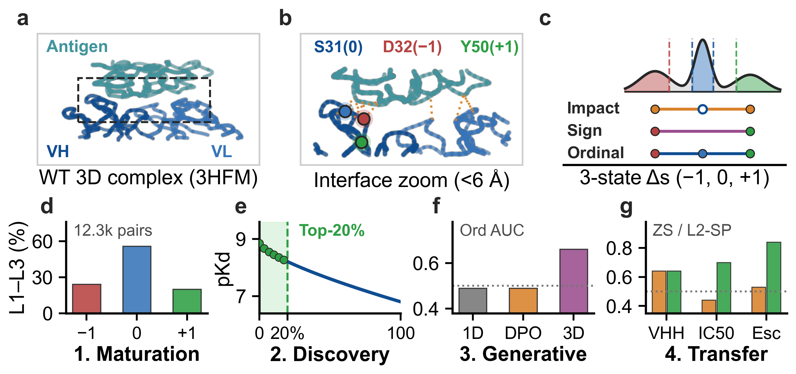
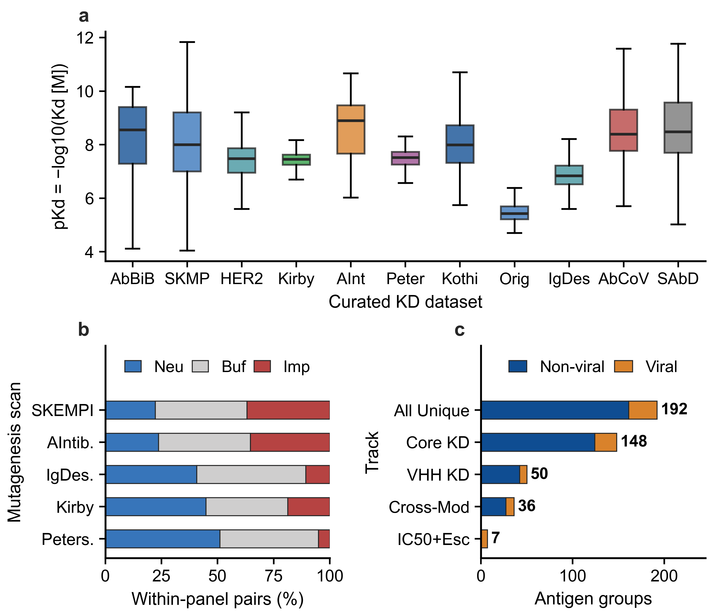

# AbRank v2: A Sequence- and Lineage-Disjoint 3-State Antibody–Antigen Affinity Ranking Benchmark

[](LICENSE)
[](pyproject.toml)
[](https://www.kaggle.com/datasets/aisysbio/abrank)
[](https://github.com/AI-SysBio/logica/tree/main/antibodies-abrank)

**AbRank v2** is a standardized, sequence- and lineage-disjoint (`<50%` antigen identity, `<80%` antibody clonal-lineage identity) benchmark for evaluating sequence-based, multi-chain PLM, 3D inverse-folding/GNN, co-folding, and generative antibody–antigen binding models across **local mutational landscapes (`L1`–`L3`)**, **same-antigen candidate ranking (`Candidate`, `Lev > 3`)**, **unfiltered continuous variant panels (`*_pointwise.tsv`)**, **cross-antigen discovery (`Global`)**, **cross-modal experimental readouts (`Enrichment`, `ELISA`, `DDG`, `EC50`, `DMS`)**, **viral neutralization & escape transfer (`IC50`, `Escape`)**, and **single-domain nanobodies (`VHH`)**.

<p align="center">
  
</p>

> **Looking for the `AbLang2-Paired + ESM-2` LogiCA baseline on AbRank?**
> See the companion [**AI-SysBio/logica → `antibodies-abrank/`**](https://github.com/AI-SysBio/logica/tree/main/antibodies-abrank) suite, which loads AbRank directly from Kaggle (or a local checkout of this repo), trains & evaluates `AbLang2-Paired ↔ ESM-2` LogiCA, and outputs submission files compatible with `python -m abrank.evaluate`.

---

## Quick Benchmark: The 4 Core AbRank Community Suites

To standardize comparison across papers without sifting through dozens of sub-splits, **any sequence, 3D inverse-folding/GNN, co-folding, generative binder, or DPO reward/verifier model can be scored on the 4 AbRank Core Suites** with a single command (`python -m abrank.evaluate --suite <name> --preds <file.tsv>`—accepting *either* pairwise `pair_id,pred_diff[,pred_impact]` or pointwise `AbAgID,pred_score` tables):

| Flagship Suite (`--suite`) | Decision Gate & Scope (`<50%` Ag, `<80%` Ab) | Allowed Structural Inputs | Primary Headline Metric(s) | Reference Baselines |
| :--- | :--- | :--- | :--- | :--- |
| **`AbRank-Maturation`** (`--suite maturation`) | **22-Cluster `LOACO` Local Edits** (`12,267` `L1–L3` $K_d$ pairs; `5,426` impactful `±1`) | **`Track 1A: Prospective`** (Seq / predicted 3D only, no co-crystal)<br>**`Track 1B: WT-3D`** (Single solved WT parental complex; `47` scaffolds) | Cluster-Macro **3-Class Ordinal AUC** (+ Sign & Impact AUC, 95% cluster CI) | **1A (1D)**: **`0.569` Ord / `0.597` Sign / `0.555` Imp** (`LogiCA`)<br>**1B (WT-3D)**: **`0.616` Ord / `0.678` Sign** (`ProteinMPNN`), **`0.636` Imp** (`ANTIPASTI`) |
| **`AbRank-Discovery`** (`--suite discovery`) | **25 Unfiltered `LOACO` Library Panels** (`6–200` clones, $d_{\mathrm{Lev}} > 3$) + **`VHH` $K_d$** (`11` targets) | Sequence / predicted 3D (pointwise `AbAgID,pred_score` works directly!) | Panel-Macro **`Top-Binder AUC`** & **`Precision@Top-20%`** (+ `VHH` Ord AUC) | **`0.576` Top-Bind** (`GearBind`), **`0.642` VHH Ord** ($K_d$ prior) |
| **`AbRank-Generative`** (`--suite generative`) | **`1,354` Wet-Lab Generative AI Designs** (`20` panels, `5,069` pairs across `IgDesign`, `Origin1`, `BoltzGen_VHH`, `Germinal`, `AIntibody`, `Shanker`) | Conditional generative log-likelihood (`AbAgID,pred_score`) or 3-state DPO verifier (`pair_id,pred_diff`) | **`Generative Ordinal AUC`**, **`Precision@Top-20%`**, & **`Top-20% Regret` ($\Delta\text{p}K_d \downarrow$)** | **1D**: **`0.563` Ord** (`Biophys+AAC`), **`0.547` Imp** (`LogiCA`)<br>**3D**: **`0.656` Ord / `0.736` Sign** (`GearBind`), **`0.308` Prec@20%** (`ESM-IF1`), **`0.252` Regret** (`AntiFold`) |
| **`AbRank-Transfer`** (`--suite transfer`) | **Biochemical $\to$ Functional Adaptation** (`Viral IC50`, `RBD Escape`, `AbAgym 45-DMS`, `ELISA`, `ΔΔG`) | `0%` zero-shot vs. `10%` few-shot (`~200` target pairs) under 5-fold GroupCV | Per-Antigen Macro **3-Class Ordinal AUC** & **Sign AUC** | $IC_{50}$: `0.438` (`0%` ZS) $\to$ **`0.702` Ord / `0.808` Sign** ($10\%+$ $L^2$-SP) |

```bash
# Score any pointwise (AbAgID, pred_score) or pairwise (pair_id, pred_diff) predictions in one command
# (automatically uses local data/benchmark/, ABRANK_DATA_DIR, --data-dir, or --kaggle-dataset):
python -m abrank.evaluate --suite maturation --track prospective --preds my_preds.tsv
python -m abrank.evaluate --suite maturation --track wt-3d       --preds my_3d_preds.tsv
python -m abrank.evaluate --suite discovery                      --preds my_pointwise_scores.tsv
python -m abrank.evaluate --suite generative                     --preds my_gen_loglik_or_verifier.tsv
python -m abrank.evaluate --suite transfer                       --preds my_transfer_preds.tsv
```

---

## Dataset Overview & Key Design Principles

<p align="center">
  
</p>

1. **3-State Noise-Buffered Relational Evaluation (`{-1: Depleted, 0: Neutral, +1: Improved}`)**:
   Rather than regressing across uncalibrated laboratory scales—or conditioning exclusively on high-magnitude mutations—AbRank v2 evaluates within-assay comparisons across **three noise-buffered states**:
   - **`Improved (+1)`**: $\Delta s \ge +m$ ($\ge 10\times$ tighter $K_d$, default $m = 1.0$)
   - **`Neutral (0)`**: $|\Delta s| \le m_{\text{neutral}}$ ($\le 2\times$ $K_d$ change, default $m_{\text{neutral}} = 0.30$, calibrated to empirical replicate noise where `95.2%` of within-platform SPR replicates fall within `|ΔpKd| ≤ 0.30`)
   - **`Depleted (-1)`**: $\Delta s \le -m$ ($\ge 10\times$ weaker $K_d$)

   This simultaneously tests **Directional Sign ROC-AUC** (`+1` vs. `-1`), **Mutation Impact / Hot-Spot Detection ROC-AUC** (`±1` vs. `0`), **3-Class Ordinal Concordance** (`-1 < 0 < +1`), and **Selective Hit ROC-AUC** (`+1` vs. `{0, -1}`), alongside **unfiltered full-panel Spearman $\rho$** across all variants (`*_pointwise.tsv`).
2. **Unified Sign Convention Across All Modalities**:
   Every pointwise assay table stores `binding_score` oriented so **higher always means stronger binding** (`pKd = 9 - log10(Kd [nM])`, `pEC50`, `-log10(IC50 [ug/mL])`, `+log10(ELISA_OD_ratio)`, `-ddG / (R T ln 10)`, `+log_enrichment`, `+DMS_binding`, `+log10(1 - escape)`). Every pairwise split provides `binding_diff = s_1 - s_2`, `logKD_diff = -binding_diff`, and `label` $\in \{-1, 0, +1\}$.
3. **Zero-Leakage Sequence- & Lineage-Disjoint Protocols (`22-Cluster LOACO` + Fixed `unseen_ag`)**:
   Homologous antigen clusters (`<50%` global sequence identity + zero `>=25 AA` subdomain overlap; empirically `≤25.0%` nearest training antigen across all `22` `LOACO` clusters) and antibody clonal lineages (`<80%` paired Fv or VHH identity; `262` paired + `114` VHH lineages) are partitioned **before** pair construction, guaranteeing **0% antigen cluster, antibody lineage, and complex overlap** across `train`, `val`, and `test`.
   - **Catalog Breadth**: `120,721` deduplicated paired-chain $K_d$ assays, `192` harmonized antigen groups (`161` non-viral, `31` viral), `24` public experimental sources, and `851` WT parental 3D scaffolds (`340` solved RCSB PDB co-crystals + `511` unbound `IgFold` Fv/VHH + RCSB antigen scaffolds).
   - **Within-Antigen Evaluable Coverage (`>=5` pairs)**: `47` core $K_d$ groups, `22` `LOACO` local clusters (`12,267` pairs, `5,426` impactful `±1`), `19` candidate clusters (`3,211` pairs), `25` unfiltered continuous panels (`1,237` variants), and `1,354` wet-lab generative AI binder designs.
4. **Assay-Consistent Construct Isolation & Per-Antigen Macro-Averaging**:
   Short linear peptide yeast-mating screens (`SARSCoV2_HR2`, 14 AA) are evaluated strictly within local antibody mutation pairs (`L1`–`L3`) and excluded from cross-antigen `Global` pairs. All splits are balanced 50/50 within every `(AbRank_group, Category)` stratum and scored by equal-weight **Per-Antigen Macro-Average** (for strata with `>=5` pairs) with 95% cluster-bootstrap CIs.

---

## Getting the Data: Kaggle Quickstart vs. From-Scratch Curation

Large curated TSVs (`~802 MB` uncompressed) and wild-type 3D scaffolds (`~400 MB`) are hosted on **Kaggle** rather than GitHub so this repository stays lightweight (`<10 MB`).

### Option 1 (Recommended): Download Pre-Built Benchmark Directly from Kaggle

```bash
git clone https://github.com/AI-SysBio/AbRank.git
cd AbRank
pip install -e ".[dev,kaggle]"

# Downloads `aisysbio/abrank` from Kaggle and links `data/benchmark/` + `data/structures/`
python scripts/00_download_from_kaggle.py --dataset aisysbio/abrank
```

You can also evaluate directly against Kaggle or a custom directory without copying files into the repo:

```bash
python -m abrank.evaluate \
  --suite maturation \
  --kaggle-dataset aisysbio/abrank \
  --preds my_predictions.tsv
```

Or in Python (for external repos such as [`AI-SysBio/logica`](https://github.com/AI-SysBio/logica/tree/main/antibodies-abrank)):

```python
from abrank.kaggle_io import resolve_benchmark_dir
import pandas as pd

bdir = resolve_benchmark_dir(kaggle_dataset="aisysbio/abrank")
assays_kd = pd.read_csv(bdir / "assays_kd.tsv", sep="\t")
test_pairs = pd.read_csv(bdir / "splits/unseen_ag/test.tsv", sep="\t")
```

### Option 2: Reproduce the Entire Benchmark from Raw Public Sources

All public sources with direct URLs (`FLAb`, `AbBiBench`, `AIntibody 2026`, `Abbate-GFRAL`, `Germinal 2026`, `BoltzGen`, `AbAgym`, `Origin-1`, `MAGMA-seq`) are fetched automatically via `scripts/01_download_raw.py`. Archival tables (`CATNAP`, `RBD_Escape_Bloom`, `SAbDab`, `SKEMPIv2`, `IgDesign`, `HER2`, `OVA`, `AbCoV`, `Porebski`, `AbDesign`) are archived in the companion [AbRank Google Drive Archive](https://drive.google.com/drive/folders/1Cez3MwqMtw6BBCr0cI16RLnNhFlLmfgV) (full provenance, DOIs, and per-source licenses in [`metadata/sources_manifest.yaml`](metadata/sources_manifest.yaml)):

```bash
# 1. Fetch and verify all 24 raw datasets
python scripts/01_download_raw.py
python scripts/01_download_raw.py --verify-only

# 2. Curate all sources into standardized 20-AA Fv/VHH + ectodomain tables (`data/benchmark/assays_*.tsv`)
python scripts/02_curate_all.py

# 3. Build deduplicated FASTAs & zero-leakage 3-state splits (`unseen_ag/`, `generative/`, `cross_modal/`, `transfer/`, `vhh/`)
python scripts/03_build_benchmark.py

# 4. Regenerate summary inventory tables (`data/benchmark/BENCHMARK_SUMMARY.md` & JSON)
python scripts/04_summary_stats.py

# Optional: rebuild splits at custom impactful/neutral margins
python scripts/03_build_benchmark.py --m 0.5 --m-neutral 0.15

# 5. Verify schema, 3-state margins, symmetries & zero-leakage assertions
pytest
```

---

## Reproducing All Benchmark Experiments

Install the optional baseline / 3D dependencies (`pip install -e ".[baselines,structures]"`), then run any benchmark script in order:

```bash
# Sequence & PLM embedding extraction + 3-state unseen-antigen & transfer baselines
python scripts/05_extract_embeddings.py
python scripts/06_run_unseen_ag_baselines.py
python scripts/07_run_modality_transfer_finetuning.py

# Wild-type 3D scaffold resolution (340 RCSB co-crystals + 511 IgFold) & 3D inverse-folding / GNN features
python scripts/08_prepare_3d_structures.py
python scripts/09_extract_structure_and_multichain_features.py
python scripts/10_run_3d_dms_ddg_benchmarks.py

# Leakage ladder, 22-cluster LOACO + controlled bound vs. unbound ablation & statistical diagnostics
python scripts/11_run_leakage_ladder.py
python scripts/12_run_loaco_and_structure_ablation.py
python scripts/13_validate_3state_and_hit_selection.py
python scripts/14_run_matched_contamination_and_rank_stats.py
python scripts/15_run_cdr_and_contact_hotspot_analysis.py
python scripts/16_run_structure_noise_and_epitope_sensitivity.py

# Generative binder reranking & paratope (Ab-Mut) vs. epitope (Ag-Mut) analyses
python scripts/18_run_generative_binder_benchmark.py
python scripts/19_run_paratope_vs_epitope_mutation_analysis.py
```

### Multi-Method, 10-Pose Co-Folding Pipeline (`AF3`, `Boltz-2`, `Chai-1`, `Protenix`)

To generate template-free 10-pose predicted WT complexes across all `851` parental scaffolds (`metadata/cofolding_manifest.tsv`) and evaluate `DockQ` + multi-pose `LOACO` strategies, follow [`scripts/cofolding/README.md`](scripts/cofolding/README.md):

```bash
PYTHONPATH=src python3 scripts/cofolding/01_generate_cofolding_inputs.py --methods af3 boltz2 chai1 protenix --num-poses 10
bash scripts/cofolding/02_run_cofolding_worker.sh --method boltz2 --num-poses 10
PYTHONPATH=src python3 scripts/cofolding/03_ingest_and_evaluate_cofolded.py --method boltz2 --max-poses 10
```

### Companion `AbLang2-Paired + ESM-2` LogiCA Implementation

For end-to-end native-logit cross-attention training, evaluation on all 4 AbRank Core Suites, 2D paratope dependency maps, and antigen-conditioned CDR Coordinate Gibbs affinity maturation, use the modular **`logica`** toolbox in the companion repository:

```bash
git clone https://github.com/AI-SysBio/logica.git
cd logica && pip install -e ".[all]"

# Train & evaluate AbLang2-Paired + ESM-2 LogiCA directly on AbRank from Kaggle:
python antibodies-abrank/scripts/02_train_ablang_esm_logica.py --kaggle-dataset aisysbio/abrank
python antibodies-abrank/scripts/03_evaluate_on_abrank.py --suite maturation --kaggle-dataset aisysbio/abrank
```

---

## Repository Layout

```text
AbRank/
├── configs/
│   └── benchmark.yaml                # Single source of truth (m=1.0, m_neutral=0.30, caps, clustering thresholds)
├── metadata/
│   ├── croissant.json                # MLCommons Croissant 1.0 + Responsible AI (RAI) dataset metadata
│   ├── kaggle-dataset-metadata.json  # Kaggle dataset release metadata (`aisysbio/abrank`)
│   ├── cofolding_manifest.tsv        # All 851 WT parental Fv/VHH + Ag scaffolds (340 solved + 511 unresolved)
│   ├── sources_manifest.yaml         # Citations, DOIs, licenses, and download URLs for all 24 raw sources
│   ├── antigen_catalog.tsv           # Curated reference antigen sequences
│   ├── pdb_mapping.tsv               # Canonical PDB -> Antigen / Antibody / Viral-NonViral taxonomy
│   ├── structure_templates.yaml      # Experimental RCSB co-crystal & antigen structure mappings
│   └── constructs/                   # Exact assayed ectodomain FASTAs (AIntibody, Abbate, Germinal, BoltzGen, Shanker, MAGMA-seq)
├── src/abrank/
│   ├── config.py                     # Configuration & repository path helpers
│   ├── kaggle_io.py                  # Kaggle (`kagglehub` / `kaggle` CLI) & local benchmark resolver
│   ├── download.py                   # Automated raw dataset downloader & verifier
│   ├── schema.py                     # 20-AA hygiene, recombinant tag & Fab->Fv trimming, sign conventions
│   ├── taxonomy.py                   # Canonical Ag_group unification & SAbDab species/PDB overrides
│   ├── curate/                       # Modular source-specific curation (kd_core, kd_2026, cross_modal, transfer, vhh)
│   ├── structures/                   # Experimental RCSB co-crystal + IgFold 3D resolver, FreeSASA/PRODIGY, GNM DCCM & Foldseek 3Di
│   ├── baselines/                    # Sequence, PLM, 1D LogiCA, SaProt, MINT, ESM-IF1, ProteinMPNN, AntiFold, ANTIPASTI, GearBind & WALLE-Affinity
│   ├── pairs.py                      # Deterministic 3-state Global, L1-L3, and Candidate pair builders
│   ├── splits.py                     # Canonical IDs, FASTA export, lineage/antigen clustering, zero-leakage splits & panels
│   ├── evaluate.py                   # Official 3-state (Sign, Impact, Ordinal, Hit) & full-panel Spearman evaluator
│   └── stats.py                      # Automated JSON + Markdown benchmark summary generator
├── scripts/
│   ├── 00_download_from_kaggle.py    # Quickstart: fetch curated benchmark release from Kaggle
│   ├── 00_prepare_kaggle_bundle.py   # Maintainer helper: stage Kaggle upload bundle + dataset-metadata.json
│   ├── 01_download_raw.py ... 19_*.py # Full from-scratch curation & benchmark reproduction pipeline
│   └── cofolding/                    # Multi-method (AF3, Boltz-2, Chai-1, Protenix) 10-pose WT co-folding suite
├── data/benchmark/
│   ├── BENCHMARK_SUMMARY.md          # Full dataset & 3-state split statistics table (tracked in Git)
│   └── benchmark_summary.json        # Machine-readable dataset & split counts (tracked in Git)
├── results/                          # Reproducible JSON & Markdown benchmark reports + figures/
└── tests/
    └── test_benchmark_integrity.py   # Pytest suite verifying schema, 3-state margins, symmetries & zero-leakage
```

---

## Summary Statistics & Benchmark Reports

- **Dataset & 3-State Split Inventory**: [`data/benchmark/BENCHMARK_SUMMARY.md`](data/benchmark/BENCHMARK_SUMMARY.md) & Croissant Metadata [`metadata/croissant.json`](metadata/croissant.json)
- **Leave-One-Antigen-Cluster-Out (`22-Cluster LOACO`) & Controlled 3D Ablation**: [`results/LOACO_EVALUATION.md`](results/LOACO_EVALUATION.md)
- **Generative Binder Reranking, Conditional Log-Likelihood & DPO Verifier Benchmark (`1,354` AI Designs)**: [`results/GENERATIVE_BINDER_BENCHMARK.md`](results/GENERATIVE_BINDER_BENCHMARK.md)
- **Paratope (`Ab-Mut`) vs. Epitope (`Ag-Mut`) Two-Sided Generalization & Escape Stratification**: [`results/PARATOPE_VS_EPITOPE_MUTATIONS.md`](results/PARATOPE_VS_EPITOPE_MUTATIONS.md)
- **5-Rung Evaluation Leakage Ladder & Matched Fixed-Test Contamination Stats**: [`results/LEAKAGE_LADDER.md`](results/LEAKAGE_LADDER.md) & [`results/MATCHED_CONTAMINATION_STATS.md`](results/MATCHED_CONTAMINATION_STATS.md)
- **CDR vs. Framework Stratification & Single-WT 3D Hot-Spot Impact Baselines**: [`results/CDR_CONTACT_HOTSPOT_ANALYSIS.md`](results/CDR_CONTACT_HOTSPOT_ANALYSIS.md)
- **Structural Noise (`0.5–3.5 Å`), Misplaced Contacts & Epitope-Localization Sensitivity**: [`results/STRUCTURE_NOISE_SENSITIVITY.md`](results/STRUCTURE_NOISE_SENSITIVITY.md)
- **Multi-Method 10-Pose Co-Folding Benchmark (`34,040` Poses across `AF3` / `Boltz-2` / `Chai-1` / `Protenix`)**: [`results/COFOLDING_BENCHMARK_EVALUATION.md`](results/COFOLDING_BENCHMARK_EVALUATION.md), [`scripts/cofolding/README.md`](scripts/cofolding/README.md) & [`metadata/cofolding_manifest.tsv`](metadata/cofolding_manifest.tsv)
- **3-State Replicate Calibration, Margin Sensitivity & Wet-Lab Hit Selection**: [`results/THREE_STATE_VALIDATION.md`](results/THREE_STATE_VALIDATION.md)
- **Fixed-Split Unseen-Antigen (`unseen_ag`) Leaderboard**: [`results/UNSEEN_ANTIGEN_BASELINES.md`](results/UNSEEN_ANTIGEN_BASELINES.md)
- **Cross-Assay & VHH Transfer / Fine-Tuning (`KD` $\to$ `ELISA`, `IC50`, `ΔΔG`, `Escape`, `VHH`)**: [`results/MODALITY_TRANSFER_AND_FINETUNING.md`](results/MODALITY_TRANSFER_AND_FINETUNING.md)
- **3D Structure-Conditioned Benchmarks (`AbAgym` DMS, `SKEMPI 2.0` $\Delta\Delta G$, `AbDesign`, `VHH`)**: [`results/STRUCTURE_DMS_DDG_BENCHMARKS.md`](results/STRUCTURE_DMS_DDG_BENCHMARKS.md)

---

## Citation & License

Code in this repository is released under the [MIT License](LICENSE). Curated dataset records remain subject to their respective upstream open licenses documented in [`metadata/sources_manifest.yaml`](metadata/sources_manifest.yaml). See [`CITATION.cff`](CITATION.cff) for BibTeX/CFF citation details.
